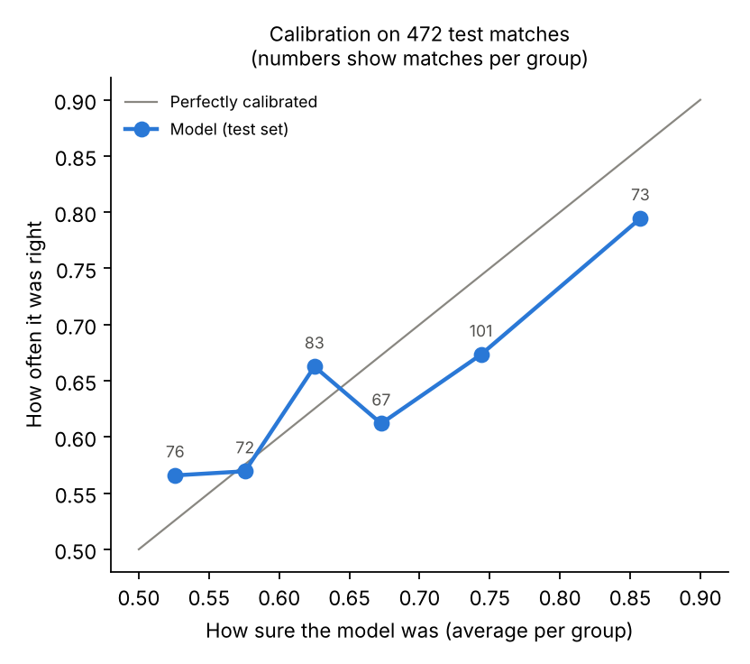

# ODI Win Predictor

Predicts which team wins a men's One Day International, using only what is known before the first ball.

Built with Python (pandas, scikit-learn). Data from [Cricsheet](https://cricsheet.org) (ODC-By licence, credit Cricsheet when you share it).

## Data

- 2,477 men's ODIs, June 2002 to October 2026
- Ties and no-results removed
- Women's matches removed (they were mixed into the same download)
- Cricsheet writes many grounds more than one way ("Lord's" and "Lord's, London"). `venues.py` joins them: the 317 venue names in the match file become 181 grounds. (The raw men's files have 319 names. The other 2 belong to ties or no-results, which are removed.)

## Method

Every feature uses earlier matches only. Nothing from the future leaks in.

- **Elo rating** for each team, updated after every match. The update speed (K=30) was picked using matches before 2023 only. Every team starts at 1500 in 2002, so the first few years are a warm-up. Associate teams start level with the full members, which is not true, so early ratings for them are rough.
- **Home advantage**: whether Team A or Team B is playing in its own country, or neither (neutral ground). `venues.py` works out each ground's country from its name and city, which I matched by hand. The West Indies count as one home. England and Wales count as one. Neutral grounds such as Dubai and Sharjah could be misjudged for a team that regularly plays there. In this data the home team won 59% of 1,865 matches.
- **Recent form**: results of the last 10 matches
- **Venue**: how often each team has played at the ground, and its win rate there
- **Squad experience**: average earlier ODI appearances of the XI
- **Team experience**: how many ODIs the team has played
- **Toss**: who won it and who bats first

Models: logistic regression and gradient boosting. Both are built so swapping Team A and Team B flips the prediction exactly (checked in code).

## Test

Trained on the 2,005 matches before 1 January 2023. Tested on the 472 matches since. The model never sees a test match before predicting it.

| Model | Accuracy | 95% range | Log loss |
|---|---|---|---|
| Coin flip | 50.0% | n/a | 0.693 |
| Higher Elo wins | 60.8% | 56.1 to 65.0 | 0.667 |
| Logistic: Elo only | 60.8% | 56.4 to 65.5 | 0.664 |
| Logistic: Elo + home advantage | 63.6% | 59.1 to 67.8 | 0.640 |
| Logistic: Elo + form, venue, squad (no home, no toss) | 63.8% | 59.5 to 68.2 | 0.644 |
| Logistic: all features | 64.8% | 60.4 to 69.1 | 0.642 |
| Boosting: all features | 66.5% | 62.5 to 70.8 | 0.635 |

Lower log loss is better. On the 257 test matches between two full-member teams, the all-features logistic scores 65.0%.

**The numbers are probably a little optimistic.** The 472 matches since 2023 are also the last four years of the 1,118 walk-forward matches, so only 646 of the 1,118 are new. I also added home advantage, and chose the picker's clues, after I had seen the 2023+ results.

### Is each model really better than Elo alone?

`train_evaluate.py` re-samples the test matches 2,000 times to see whether the gain in log loss (Elo only minus the new model) could be luck. A range that stays above zero means the gain is probably real.

| Model | Log-loss gain | 95% range |
|---|---|---|
| Elo + home advantage | 0.023 | 0.010 to 0.038 |
| Elo + form, venue, squad | 0.019 | -0.002 to 0.041 |
| All features | 0.022 | -0.003 to 0.047 |
| Boosting: all features | 0.028 | 0.003 to 0.054 |

### Walk-forward test: does it hold across years?

One split gives one 472-match test. `walk_forward.py` repeats the test for every year from 2016 to 2026: for each year the model is trained on earlier matches only (and the Elo speed K is picked again using earlier matches only), then tested on that year. That gives 1,118 test matches.

| Model | Accuracy | 95% range | Log loss |
|---|---|---|---|
| Higher Elo wins | 64.2% | 61.4 to 66.9 | 0.638 |
| Logistic: Elo only | 64.2% | 61.3 to 67.1 | 0.636 |
| Logistic: Elo + home advantage | 66.2% | 63.3 to 68.9 | 0.618 |
| Logistic: all features | 67.4% | 64.6 to 70.1 | 0.616 |

The all-features model is ahead of "higher Elo wins" in 10 of 11 years. Its log-loss gain over Elo only is 0.020 (range 0.003 to 0.038), so it only just clears zero. Home advantage alone gains 0.019 (range 0.009 to 0.028). 2026 is the weakest year (about 55% for both). Per-year numbers are in `results/walk_forward_by_year.csv`.

### Player strength did not help

`build_squad_strength.py` rates each side's XI from what its players did in earlier matches (batting runs per ball, runs conceded per ball, wickets per ball, each blended with the all-matches average so debutants start at average). Nothing from the match itself is used.

Adding it did not improve the model. On the 472-match test it scored 63.8% against 64.8% without it, and across the 1,118 walk-forward matches 66.5% against 67.4%, with the same log loss (0.615 and 0.616). The batting number correlates 0.72 with Elo, so it mostly repeats what Elo already knows. This is a negative result for this simple version. A better version (weighting the top order, adjusting for opposition) might do better, but I have not tested that.

## What I found

- Team strength (Elo) is the biggest clue, and home advantage is second. Adding home advantage alone is the one clear gain: its range stays above zero.
- The other extra features together add roughly 1 to 2 points but are **not proven**: their ranges include zero. 472 test matches is too few to be sure.
- Boosting scores best (66.5%), but its range overlaps the logistic models and only just clears zero, so I would not claim it is better.
- The toss does not matter (coefficient close to 0). Batting second is a small edge.
- The model is a little overconfident at the top. In the 73 matches where it was 80% or more sure (86% on average), the favourite won 79.5%.



### The odd-looking coefficients

Standardised coefficients, all-features logistic: Elo 0.73, home 0.46, matches played 0.35, squad experience 0.26, venue experience -0.15, batting first -0.14, venue win rate 0.10, form -0.06, toss 0.01.

- **Matches played is large.** Teams that have played more ODIs are mostly the stronger full members, so it overlaps with Elo. It is probably also a stand-in for the associate teams being rated too high early on (see the warm-up note above). I have not tested this.
- **Form is slightly negative.** Form is mostly already inside Elo, and the size (-0.06) is tiny. I read it as noise, not as "bad form helps".
- **Venue experience is negative.** Before home advantage was added it was positive. Home advantage now carries that signal, and what is left is a small correction. I would not read it as a real effect.

## Limits

- Not compared with bookmaker odds. I have no odds data, so I make no claim about beating them.
- No player quality, pitch, weather or injuries. Two teams with the same Elo can be very different on the day.
- Home advantage depends on my hand-matched list of ground countries. A few neutral grounds could be wrong.
- The data is not every ODI. Cricsheet only holds matches it has ball-by-ball records for. Cricsheet withholds every Afghanistan men's match by policy (162 matches, listed in the README inside the download), so the file has no Afghanistan games at all and only 39 of the 48 matches from the 2023 World Cup. Re-downloading does not fix this. Missing matches make ratings, form and experience counts slightly off.
- Model is trained once and not refitted during the test period. Elo does keep updating.

## Zimbabwe and Queens Sports Club (Bulawayo)

This is descriptive, not a finding.

- The file has 271 Zimbabwe matches, 137 played in Zimbabwe (Harare 64, Bulawayo 55). Queens Sports Club has 50 matches under its cleaned name.
- Zimbabwe won 43 of the 137 matches played at home (31%) and 22 of the 134 played elsewhere (16%).
- Zimbabwe's Elo fell from 1451 in 2003 to about 1190 by 2006, stayed roughly between 1200 and 1400 until 2022, then rose to 1453 after the last match in the data.
- Only 31 test matches involve Zimbabwe, and the model picked 64.5% of them correctly. That is far too few to say how it does on Zimbabwe.

## Elo ratings after the last match in the data (25 Oct 2026)

India 1756, New Zealand 1745, Pakistan 1720, Australia 1690, South Africa 1690, Sri Lanka 1625, England 1623, Bangladesh 1583.

This is a snapshot of recent results. It is not a World Cup forecast.

## Run it

```
pip install -r requirements.txt
python build_dataset.py --raw odis_json --out data
python build_squad_strength.py --raw odis_json --out data
python train_evaluate.py --data data --out results
python walk_forward.py --data data --out results
```

`requirements.txt` lists the packages without version numbers. `requirements-tested.txt` has the exact versions I ran it with (pandas 3.0.5, numpy 2.5.3, scikit-learn 1.9.1, matplotlib 3.11.2); use it if you want the same results. `odis_json` is the unzipped ODI file from cricsheet.org/downloads. To check the ground-to-country list: `python venues.py --raw odis_json`.

## Next steps

- Live win probability that updates every over
- A better player-based team rating (the simple version added nothing, see above)
- Fixture predictions for the 2027 World Cup

## Predict a match (dashboard page)

`export_picker.py` fits a small model for the "Predict a match" page and saves it to `results/picker_model.json`:

    python export_picker.py --raw path/to/odis_json --data data --out results

It uses only what a menu can ask for: team strength (Elo), home advantage, ODIs played, and the toss. Squad experience, ground record and form are left out (form has a tiny, slightly negative weight, so I read it as noise).

- Same test as above: fitted before 2023, tested on the 472 matches since. Accuracy 65.3% without the toss and 64.6% with it. That is a difference of about three matches, so **the toss makes no real difference**. It is an optional input for curiosity, and the two versions should not be ranked.
- Team strength is as of the last match in the data. Only teams with 20+ ODIs and a match since 2023 are listed.
- **Big mismatches (checked on the 472 test matches):** when team strength differed by more than 200 Elo points (66 matches), it gave the favourite about 80% and the favourite won 74%. When it was 85% or more sure (33 matches), it said about 90% and the favourite won 88%. That is mildly overconfident, on small samples.
- **Likely cause:** the "ODIs played" clue pushes newer teams down on top of Elo. For example Canada v Zimbabwe comes out at 16%, where team strength alone gives 33%. Dropping that clue made the test results worse (accuracy 63.6% against 65.3%, log loss 0.640 against 0.631), so I kept it, but treat very low chances for newer teams with care.
- Never compared with bookmaker odds.

## Player explorer and Pick your XI

`build_player_stats.py` works out each player's numbers from the ball-by-ball files (about 10 seconds):

    python build_player_stats.py --raw path/to/odis_json --out data

It writes `player_stats_recent.csv` (matches since 1 Jan 2023), `player_stats_all.csv` and `player_roles_meta.json`.

**Stats:** batting average (runs per dismissal), strike rate, boundary % (share of runs from fours and sixes), usual batting position, economy, bowling average, balls per wicket, dot-ball %.

**Roles are my own rules, not official labels.**
- All-rounder: qualifies as a batter and a bowler, and bats in the top seven.
- Bowler: bowls 3+ overs in every match they play.
- Power hitter: bats at 1 to 3 and scores faster than 75% of players in those spots (cutoff 92.0 since 2023, 87.7 all-time).
- Anchor: the rest of the top four.
- Finisher: bats at five to seven.
- Included once a player has 10 innings or 20 overs since 2023 (30 innings or 100 overs all-time).

**Limits**
- The data has no playing roles, batting hand, pace or spin, or photos.
- Cricsheet withholds Afghanistan men's matches by policy, so there are no Afghanistan players (no Rashid Khan).
- It holds 39 of the 48 games from the 2023 World Cup. Career totals can sit a little below official numbers.
- Team numbers in Pick your XI add up what each player did in the period. They are not a forecast of how the team would play together.
- Names are Cricsheet's short form (V Kohli, RG Sharma).

Open `odi_dashboard.html` in a browser for all four pages (match predictor, predict a match, player explorer, pick your XI).
